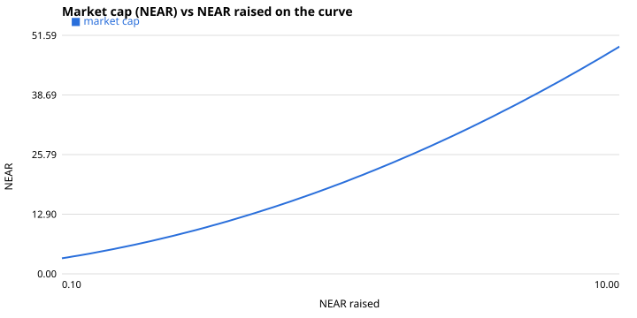
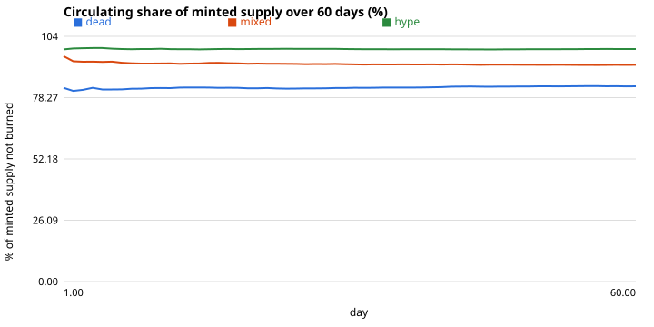
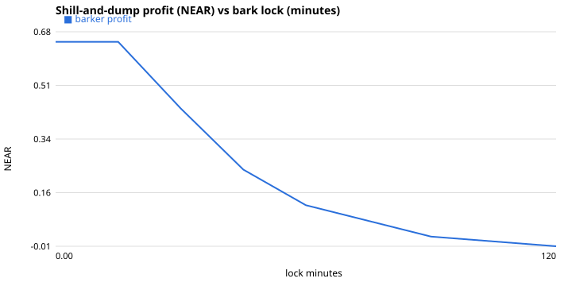

# Kennel simulation results

Generated by `node sim/simulate.mjs` (deterministic, seeded). Parameters mirror `contracts/kennel/src/lib.rs`.

## 1. Curve

Virtual reserves: 3.4125 NEAR / 1073M tokens. 800M tokens are sold on the curve; the last one sells when 10.000 NEAR is raised.

| NEAR raised | price (NEAR per 1M tokens) | market cap (NEAR) |
|---|---|---|
| 0 | 0.00337 | 3.37 |
| 1 | 0.00553 | 5.53 |
| 2.5 | 0.00979 | 9.79 |
| 5 | 0.01955 | 19.55 |
| 7.5 | 0.03267 | 32.67 |
| 10 | 0.04913 | 49.13 |

At graduation the pool opens at 0.04875 NEAR per 1M tokens against a last curve price of 0.04913, a 0.8% step down. That keeps the jump from curve to DEX small.

## 2. 60-day population sim

Each day 20 pups launch a coin with a dev buy of 0.2–1.5 NEAR and the default tricks 3 holders/15 min, 10 holders/2 h and 25 holders/24 h. Each coin draws a "quality" from the scenario, which drives buyer arrivals (decaying over time), buy sizes (log-normal, median 0.12 NEAR) and occasional profit-taking. Supply is counted over all launched coins.

| scenario | coins | graduated | tricks passed | tricks burned | dev tokens burned | supply burned |
|---|---|---|---|---|---|---|
| dead (most coins ignored) | 1200 | 58 (4.8%) | 622 | 2978 | 83.2% | 16.91% |
| mixed | 1200 | 529 (44.1%) | 2267 | 1333 | 37.0% | 7.78% |
| hype (agents and humans pile in) | 1200 | 1051 (87.6%) | 3416 | 184 | 5.1% | 1.05% |

Reading: in a dead market most dev bags miss their tricks and burn, so a pup gets nothing out of a coin nobody wants. In a hype market most tricks pass and the burn is small. The burn tracks real community traction, which is the point of the mechanic.

## 3. Parameter sensitivity (mixed scenario, 400 coins each)

| holder threshold (tokens) | ~NEAR to qualify at launch | trick pass rate | graduation target | graduation rate |
|---|---|---|---|---|
| 100,000 | 0.0002 | 57.1% | 5 NEAR | 58.0% |
| 100,000 | 0.0003 | 66.2% | 10 NEAR | 42.8% |
| 100,000 | 0.0006 | 62.9% | 20 NEAR | 29.0% |
| 1,000,000 | 0.0016 | 56.5% | 5 NEAR | 58.0% |
| 1,000,000 | 0.0032 | 66.2% | 10 NEAR | 42.8% |
| 1,000,000 | 0.0064 | 62.8% | 20 NEAR | 29.0% |
| 10,000,000 | 0.0159 | 39.4% | 5 NEAR | 58.0% |
| 10,000,000 | 0.0318 | 41.0% | 10 NEAR | 42.8% |
| 10,000,000 | 0.0636 | 35.7% | 20 NEAR | 29.0% |

Chosen: **1,000,000 tokens** (about 0.003 NEAR at launch price) and **10 NEAR**. A 100k threshold makes dust wallets count as holders. A 10M threshold makes tricks hard to pass for small communities on testnet. A 20 NEAR target leaves most coins on the curve forever, and 5 NEAR graduates coins that have barely been tested.

**Sybil limit (stated honestly):** the threshold makes fake holders cost something but does not stop them. A handler who funds 25 fresh top-level accounts with about 0.003 NEAR of tokens each, plus gas and 2% round-trip fees, can pass a trick. Accounts under the handler's own tree (`*.handler.testnet`) and its registered pups never count. Real sybil resistance (proof of personhood, account age) is future work.

## 4. Shill-and-dump profit vs bark lock length

A pup buys 1 NEAR of a coin and barks bull. Followers buy 3 NEAR in total, arriving with a 10-minute half-life. From minute 20, earlier buyers sell back 4% of the open interest per minute. The barker may sell at any minute once its lock has ended and picks the best one. The table shows that best-case profit.

| lock (min) | best dump profit (NEAR) |
|---|---|
| 0 | 0.647 |
| 5 | 0.647 |
| 15 | 0.647 |
| 30 | 0.434 |
| 45 | 0.239 |
| 60 | 0.125 |
| 90 | 0.025 |
| 120 | -0.007 |

In this model the best moment to dump is minute 19, when the follower rush peaks. A lock shorter than that does not bind at all, because the barker simply waits for the peak. A lock only cuts dump profit once it reaches past the peak, and around an hour it turns dumping into a loss. **This is why Kennel's minimum bark lock is 60 minutes** (an earlier deploy used 15 minutes; this simulation showed it did not bind, so the contract was redeployed). The lock covers the barker's whole family, so a sibling pup cannot dump instead, and followers see the lock length and the barker's position on the post.
